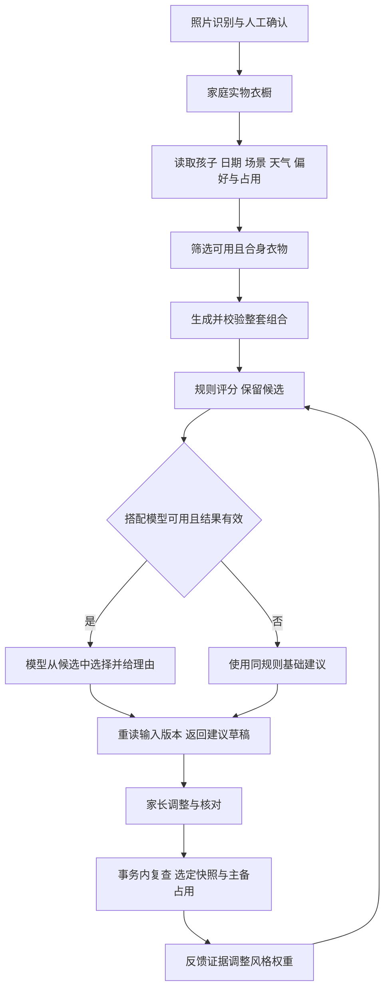

# 智搭 AI 搭配技术逻辑

2026-10-04。依据当前 `codex/phase-a` 工作区的 C 搭配与 D 反馈实现梳理。本文说明现有行为、数据依赖和改进方向；本轮只新增说明文档，没有修改算法、配置或调用模型。

当前采用服务端规则与大模型配合：服务端决定衣物资格、组合结构和约束；规则对整套评分；大模型从提供的候选中选择并解释；保存前重新核对实物和家庭安排。搭配模型在代码配置中默认关闭，规则建议可以独立运行。响应中的 `source=rules/model` 与 `cached` 可用于判断实际来源。识别模型和搭配模型是两个独立环节，识别成功不表示搭配模型已启用。

## 总体流程

图中的反馈只影响审美排序。可用状态、当前孩子合身和明确约束仍由服务端校验。已选方案保留选定时的快照，之后天气或衣物变化只生成当前变化提示。

## 输入数据

| 输入 | 在当前逻辑中的用途 |
| --- | --- |
| 家庭、成员权限、孩子 | 限定真实衣物和操作范围；仅查看成员不发起新推荐或保存 |
| 衣物 ID、类别、颜色、图案、厚薄、版本 | 组合、评分、模型候选与保存复查 |
| 共享可用状态 | 仅 ready 自动入选；washing、missing 和归档排除 |
| 按孩子独立的合身 | 仅 fit 自动入选；small、large、unknown 不自动当作合身 |
| 目标实际日期、地点、预报 | 读取对应日天气；家庭时区解释今天／明天；当前穿衣规则主要消费最低／最高温 |
| 年龄与场景 | 组合要求，例如非日常场景且月龄至少 12 时要求鞋，运动场景不选连衣裙 |
| 体感与风格 | 体感调整规则温度；家庭／当前成员／指定成员的风格依据分别解析 |
| 固定、本次排除、上一套、备用 | 保留固定件、剔除排除件、换套避开原组合、核对主备兼容 |
| 当日家庭占用 | 自动建议避开其他孩子已安排的实物；明确共用进入分时核对 |

照片的类别、配色可以由识别提出草稿；合身和实物状态需要事实确认。身高体重与宽松偏好目前进入上下文／签名，但当前规则没有据此计算衣物尺寸或版型适配。

源码：[请求结构](/Users/ll/Documents/智搭（儿童）/.worktrees/phase-a/backend/app/v2/outfits/schemas.py:10)、[上下文读取](/Users/ll/Documents/智搭（儿童）/.worktrees/phase-a/backend/app/v2/outfits/service.py:88)、[衣橱字段](/Users/ll/Documents/智搭（儿童）/.worktrees/phase-a/backend/app/v2/wardrobe/schemas.py:4)。

## 衣物筛选与整套结构

衣物必须属于当前家庭且当前孩子有有效关系，状态可用、未归档并已确认合身。固定件失效时保留问题并要求核对或明确解除固定；缺件时返回缺项，不能放宽状态或虚构衣物。

主体模板为上衣加下装，或者单件连衣裙，或者单件连体衣。根据条件添加外套和鞋；配饰目前主要通过固定指定进入。整套中同一实物不能重复，鞋与外套各至多一件。运动场景排除连衣裙。天气与年龄影响所需单品，不是所有情况固定要求上衣、裤子、鞋三件。

当前实现中的温度判断为工程启发式：怕冷／怕热按最低和最高温分别偏移 -3／+3；低于 15 时要求外套；高温会排除厚衣；低于 10 且相关厚薄都已知时，以主体最薄档加外套档检查暖度。任一相关厚薄未知时，该暖度检查跳过并提示核对。未知天气不伪造温度。通过组合校验不表示低温适宜性已经证实；上述阈值与档位分值尚未通过实际衣橱评测校准。

协调性也进入当前硬校验：主体与外搭超过三种非中性色，或多个图案件的图案和色集不同，会被拦截；同图案同色集的套装可以通过。因此部分可能好看的混搭在规则阶段就被挡住，模型不会看到它们。

源码：[资格与所需单品](/Users/ll/Documents/智搭（儿童）/.worktrees/phase-a/backend/app/v2/outfits/rules.py:19)、[整套验证](/Users/ll/Documents/智搭（儿童）/.worktrees/phase-a/backend/app/v2/outfits/rules.py:44)、[组合生成](/Users/ll/Documents/智搭（儿童）/.worktrees/phase-a/backend/app/v2/outfits/rules.py:109)。

## 规则评分与大模型选择

现有评分由单件特征加总与整套色集项组成，尚未使用图片特征或训练得到的搭配分数。

| 评分项 | 当前启发式 |
| --- | --- |
| 简洁日常 | 纯色单件 +3，再乘该风格权重 |
| 趣味印花 | 印花或波点单件 +4，再乘权重 |
| 柔和自然 | 白、米、棕、绿等色每命中一项 +2，再乘权重 |
| 运动风格 | 上衣、下装、鞋每件 +2，再乘权重 |
| 字段完整程度 | 每件厚薄已知 +1 |
| 整套配色 | 非中性色不超过两种 +4，否则按数量减分 |

组合先通过全部约束，再按分数、件数和稳定 ID 排序，保留前 100。当前适配器只把前 20 套交给大模型，输入为场景、风格权重及每件的 ID、类别、色集、图案和厚薄；没有发送照片、姓名、身体测量、年龄或天气。

模型返回 `garment_ids` 和简短中文理由。服务端要求 ID 集合及数量精确匹配服务端保留候选池中的一套；模型实际只看到前 20 套，当前返回校验针对服务端最多 100 套。重复、漏件、虚构或非法组合退回同规则基础建议。关闭、未配置或供应商失败时也走规则建议。模型调用前释放数据库事务，返回后重新读取权限、衣物、偏好和占用，变化时拒绝过期结果；这里复用调用前的天气快照并核对地点绑定，没有再次请求天气上游。

当前理由只检查字符串并截断长度，没有事实级校验；模型也没有收到年龄和天气，因此不能把自由文本里的保暖、材质或年龄适配说法当作已核实依据。

源码：[整套评分](/Users/ll/Documents/智搭（儿童）/.worktrees/phase-a/backend/app/v2/outfits/rules.py:88)、[模型输入](/Users/ll/Documents/智搭（儿童）/.worktrees/phase-a/backend/app/v2/integrations/outfits.py:10)、[返回验证与兜底](/Users/ll/Documents/智搭（儿童）/.worktrees/phase-a/backend/app/v2/outfits/service.py:234)、[默认配置](/Users/ll/Documents/智搭（儿童）/.worktrees/phase-a/backend/app/v2/core/config.py:31)。

## 调整 缓存与保存

固定后换一套，仍必须包含固定实物；本次不穿进入排除集合；换整套通过 `exclude_combination` 避开原套；没有其他合法组合时返回明确缺项或无替代。局部备用必须能对应兼容替换位置，可显式指定或按同类别定位，并验证逐件替换和全部替换后的组合；整套备用单独验证，不能与主套是完全同一批实物。

缓存签名包含家庭／孩子与版本、目标实际日期、场景、地点天气、偏好主体及学习版本、衣物和合身／状态、占用、固定排除、主备和规则版本。仅天气采集时间变化不改变有效天气签名。家庭依据的缓存可按家庭权限共享，个人依据隔离到操作者；输入变化使旧建议不再匹配。当前签名未显式包含搭配供应商、模型 ID 和提示词版本，切换模型的质量实验需要另行隔离这些缓存。

选定在短事务内复查输入版本、衣物版本、完整组合、固定排除、主备与占用。跨孩子同日共用会冲突；必须明确填写全部相关孩子的非重叠时段及原因，来源版本或用途变化后重新核对。主套和备用均占用，打包清单按实物去重。

新增保存方案与版本快照；修改保持方案身份并追加版本。同孩子同日可多套。幂等操作 ID 与提交内容绑定，响应丢失时查询原操作，不凭查询暂时查不到就再新增。天气未知的保存需要明确核对适宜性。选定、日历及反馈不表示已经实际穿过。

源码：[缓存签名](/Users/ll/Documents/智搭（儿童）/.worktrees/phase-a/backend/app/v2/outfits/signature.py:11)、[占用与分时](/Users/ll/Documents/智搭（儿童）/.worktrees/phase-a/backend/app/v2/outfits/reservations.py:32)、[保存](/Users/ll/Documents/智搭（儿童）/.worktrees/phase-a/backend/app/v2/outfits/service.py:539)。

## 反馈怎样改变搭配

现有 D 实现保留操作者、孩子、方案版本、偏好依据与反馈原因。一套方案的明确款式意见优先于弱选择信号；至少三个不同方案的同向证据才形成推断，重复事件不重复学习。

当前选择强度为 0.25，明确喜欢／不喜欢为 1；同向强度除以 6，推断权重绝对值封顶 0.5。明确风格权重为 1，并覆盖同风格的推断权重。待洗、找不到、偏小、舒适问题和跳过不作为审美学习证据。撤销或修改后的旧弱选择退出，明确意见保留；移除推断记录证据截止位置，旧事件不立即重建。

这是基于证据的启发式权重调整，目前没有梯度训练、专用神经推荐模型或时间衰减。推断只改变规则评分及交给模型的风格依据，不能将待洗衣物、未知合身或不满足约束的组合放入候选。

源码：[有效权重](/Users/ll/Documents/智搭（儿童）/.worktrees/phase-a/backend/app/v2/preferences/service.py:18)、[反馈学习](/Users/ll/Documents/智搭（儿童）/.worktrees/phase-a/backend/app/v2/preferences/service.py:144)。

## 当前限制与改进优先级

以下为基于代码的改进建议，尚未在本轮实施。

1. 补齐必要的可观察字段。当前缺袖长、裤长、明确内外层角色；高领仅按名称文字判断，宽松偏好未真正进入版型计算。照片难确认的厚薄、材质和功能由家长按需补充，保留未知。
2. 区分硬约束与审美分数。可用、合身、实物占用、固定排除继续严格校验；普通配色和图案冲突可研究改为软评分，扩大模型候选，同时用整套盲评验证收益。
3. 丰富整套审美信息。当前主要使用结构化类别与属性标签，缺少图片、轮廓和质感信息。可先增加经确认的款式描述或衣物图片特征，再比较规则基线与模型排序；不能仅凭更换大模型宣称审美更好。
4. 增强天气解释与模型契约。雨、风、湿度虽进入天气和签名，尚未实质决定雨具或防风组合；增加功能字段后再接入。模型可以返回组合 ID 和有限理由类型，服务端按实际证据生成说明。模型、提示词和候选版本应纳入质量实验缓存身份。
5. 测量真实效果。分别检查约束违规、缺件处理、固定保留、整套协调盲评、采用／调整情况、延迟与费用。当前无近期重复惩罚，反馈权重也未校准；不能把单件识别准确率当作整套搭配质量。

组合目前先枚举完整候选，再排序截为 100；大衣橱可进一步研究提前剪枝和保持候选多样性，避免规则前 20 套过于相似而限制模型选择。

## 与当前四十七图测试集的关系

现有 [47 图诊断集](/Users/ll/Documents/智搭（儿童）/.worktrees/phase-a/backend/eval/recognition_v2/dataset/desktop-2026-10-03/README.md)含 75 个主商品对象建议，仍为 AI 草稿。先确认套装拆件与类别／色集／图案，再确认具体孩子的合身、共享状态和需要的厚薄，才能组成可信的搭配输入。截图本身不能证明这些事实。

这批可以先覆盖连衣裙／连体衣／上下装模板、同款多色、固定替换、配色图案和缺项处理。主商品标签没有鞋类，外出需鞋场景可先检查明确缺鞋的行为；真实整套外出质量另补鞋与实际衣橱条件。用人工审核衣物建立固定场景，比较规则基线和模型排序，并将模拟条件与真实家长使用反馈分开报告。

本说明核对的是实际实现逻辑。已有 C／D 自动化和本地验收记录不能代替真实搭配质量评测，当前也不能仅因接口返回 source=model 就证明推荐效果提升。
