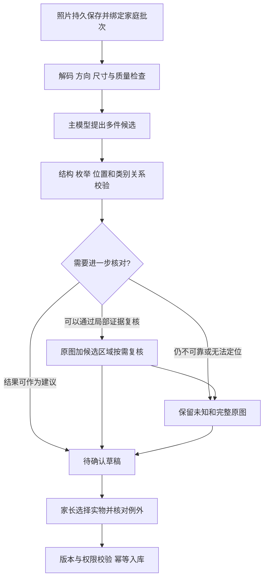

# B 阶段识别准确率技术分析与实现推演

日期：2026-10-02

状态：基于现有代码与数据的分析提案，待讨论。没有执行 B 识别实现、调用收费模型或调整供应商配置；第五组 UI 的选中态调整仍待确认，本文不代替产品或 UI 确认。

B 的识别保障应同时覆盖模型建议的正确性、异常时保留未知的能力、以及家长确认后的数据完整性。当前项目尚无可引用的可信准确率基线。建议先修复评估数据与候选契约，再比较单次识别和按需复核的收益。单靠换模型、加长提示词或提高自报 confidence，不能证明准确率提高。

## 当前代码与数据证据

| 已核实事实 | 对 B 的影响 | 证据 |
| --- | --- | --- |
| 提示词要求只识别最显眼的一件；解析数组时也只择一 | 多件图会丢失候选，与第二组流程不一致 | `backend/app/services/recognition/prompt.py:70,118`；`parsing.py:142,171` |
| 缺失字段补成 top、white、normal，完整度混入 confidence | 未识别信息变成确定建议，分数不能解释为正确概率 | `normalize.py:114,153` |
| 本轮纯函数输入空对象，输出白色上衣、普通厚度、confidence=0.72、notes 为空 | 此结果来自本地归一化，完全没有图片证据；需要优先消除这一成功路径 | 根目录 backend 虚拟环境运行 `_normalize_recognition({})` |
| sub_type 使用主类别别名表，未校验主类和细类兼容性 | 中文“衬衫”可被映射成 sub_type=top，字符串 schema 不会拦截 | `normalize.py:116`；`domain/vocab.py:39`；`schemas.py:127` |
| 新版尚未挂衣物和识别模块 | 旧接口不能直接当作 B 已完成的实现 | `backend/app/v2/main.py:39` |
| 评估目录有 20 个文件，18 个 JPEG 经哈希去重仅 4 个有效独立图片场景，另 2 个文件不可解码 | 文件数量严重高估样本规模，不能据此评估儿童服饰泛化能力 | `backend/eval/recognition/dataset/images/`，本轮 SHA256、文件格式和解码核验 |
| 根目录有 8 条草稿标签，含不可用的 img001；B 工作树没有 labels.yaml。相同图片存在不一致属性标注 | 当前标签不能直接作评估真值，数据库保存记录回填不等于独立人工审核 | 根目录 `backend/eval/recognition/dataset/labels.yaml:1,22,40,49` |
| 当前可见 checkout 未找到实际评估缓存或结果报告 | 不能声称当前已达某个准确率；此结论不等于过去从未做过测试 | 两处 `backend/eval/recognition/` 的只读文件检查 |

四个 JPEG 重复组分别为：002/004/006/009/010/012/015/016/017，003/013/018，005/007/011/019，008/014。重复照片可以保留作上传和恢复的功能样本，但不能增加独立评估样本数。007/011、003/013、008/014 的同图属性标签存在冲突，需要按统一标注原则重新审核。

旧评估框架可复用组织方式，但要补五项能力：图片解码与重复检查；多件候选匹配；字段未知状态；模型和图片内容版本；可信的离线模式。当前 `--dry-run` 只绕过计费确认，缓存缺失仍会联网，因此本轮没有运行该入口。缓存只使用文件名、提示词、run 编号；改图片、模型或归一化可能误用旧结果。baseline 动态引用生产提示词，也不是冻结历史基线。证据分别在 `labels.py:42`、`runner.py:16,44`、`ab_compare.py:78`、`prompts/baseline.py:2`。

## 先确定识别能回答什么

| 信息 | B 的处理原则 |
| --- | --- |
| 可见衣物数量、类别、主色、图案 | 模型提出候选建议，有可观察证据才给确定值，允许未知 |
| 内里、夹棉和厚薄 | 仅凭正面外观不能可靠确认；未知是合理结果。沿用 B 厚薄可暂不清楚的规则 |
| 季节、保暖和风格 | 如生成，作为可撤回的派生建议，记录规则版本；不作为必填视觉真值或 B 入库门槛 |
| 品牌、尺码 | 仅识别该候选对应的清楚文字，不根据购物标题、外观或孩子年龄猜测；缺失不阻塞 |
| 是否拥有、归属给谁 | 家长选择和确认，购物图上的其他款式不代表家庭拥有 |
| 对某个孩子合身 | 属于孩子与实物的关系；“默认合身”是明确告知后的产品默认，不能当 AI 识别成绩 |
| 可穿、待洗、找不到 | 属于共享实物状态，由用户确认或修改；不能从照片自动推断已经洗净或可以找到 |

类型未知时仍保留照片和草稿，最终入库前由家长选定类别。颜色、图案和厚薄可以未知。模型不输出年龄适用结论、合身结论或未经确认的实际可穿状态来填补识别信息。

实物计数需要先统一：两件套中的上衣和裤子分别是可选候选，可以保留套装组关系；连体衣、包屁衣、睡袋保持一件。鞋、袜、手套以一双／一对作为衣橱管理单位的规则需要进入 B 字典及标注规范。当前 set 的“上下装一体”描述与两件套别名冲突，应先修正语义，再让模型遵守。

## 三种技术方案

| 方案 | 适用与收益 | 代价和风险 | 本轮建议 |
| --- | --- | --- | --- |
| 单次视觉模型输出多件候选 | 实现简单，调用少，适合作为真实基线；可对比轻量模型与更强模型 | 小目标、遮挡、多色商品拼图仍可能漏检或串字段 | 先实现供应商无关契约并测量这条路径 |
| 主模型识别，疑难候选按需复核 | 原图定位后，只对需要的候选使用原图加裁剪图或更强模型；避免所有照片重复调用 | 第一遍漏掉的物体不能仅靠裁剪复核找回；第二模型也可能犯相同错误 | 优先验证是否在同等纠错量下改善质量与成本，通过盲测再采用 |
| 专用检测／分割模型加属性识别 | 数据充足时更容易控制位置与类别，适合规模化优化 | 需要儿童衣物数据、部署或供应商契约验证；电商模特图能力不能直接外推到家庭实拍 | 暂不作为 B 首期前置依赖 |

建议顺序是单次基线先可测，再验证按需复核。不要预先假定多模型投票、更长思考或抠图一定更准。更强模型的全图单次识别也应参与对比，可能比复杂两段式更合算。现有配置默认模型为 doubao-seed-2-0-mini-260215；实际部署可被配置覆盖，本轮没有读取密钥配置，也没有验证该模型端点的当前能力。

## 建议的识别链路

**图片输入。** 先验证真实可解码格式、EXIF 方向与尺寸；原图保留，供识别的缩放衍生图可版本化。过度压缩、小主体和偏色会影响结果，具体像素和压缩参数应在本项目样本上对比决定。家庭实拍给予简短拍摄引导，模糊时提醒重拍，也允许保留照片继续手填。提供商的图片参数依赖模型与接口，不能将某一个 detail 或像素值视为通用保障。[火山 Chat API 文档](https://docs.volcengine.com/docs/ark/chat-api?lang=zh)

**候选与身份。** 服务端建立 asset_id、attempt_id、candidate_id；候选身份不能依赖数组序号、颜色名称或浮动框。候选保存原图尺寸和版本、可选归一化位置，以及类型、主色和图案的字段结果。bbox 只能用于辅助核对，非法或不可信框退回完整原图。自动抠图仍不作为本期承诺，生成式补全不能作为真实单品图片。

重识别的建议先保留在新 attempt，人工已修改、已选择、已入库或已关联已有实物的候选保持不变。只有明确可对应的未确认候选才允许按版本更新；无法可靠对应时展示新增建议供核对。服务端不能因重新识别、字段相似或同图资产复用复制／合并实物。

**字段契约。** 每个字段记录 value/null、状态、来源、需要核对的原因。状态区分“可观察并给出建议”“未知”“不适用”“未标注”，来源区分 AI、用户修改和已告知的产品默认。精确合法别名可映射；无效枚举、含混颜色和主类／细类冲突不能通过默认值修补为成功。错误响应、空对象、非衣物图、超时、截断结果分别处理，不能进入 top/white/normal 的成功路径。

接口或模型支持时采用 JSON Schema 约束；无论供应商是否支持，应用侧都要校验字段、数量、坐标和业务关系。Schema 合法只能证明格式合规，不能证明看对了衣物。Responses 与 Messages 的结构化输出参数并不相同，具体模型能力需在 adapter 实施时核实，不能直接复制 Chat 参数到现有 Responses 请求。[火山 Responses 输出格式](https://docs.volcengine.com/docs/ark/response-lifecycle?lang=zh)、[Messages API](https://docs.volcengine.com/docs/ark/messages-api?lang=en)

**按需复核。** 触发条件包括低质量图片、主类／细类冲突、套装／连体结构不确定、定位与属性疑似串件、模型之间结果冲突。第一轮遗漏的候选需要全图检查或家长补充，不能假装裁剪可以补回。第二轮以原图和候选区域一起核对，保持场景关系；意见冲突仍留未知。建议初期每个候选最多一次视觉复核，网络重试另设上限，避免反复问到某个答案为止。只有实测有净收益才开启此策略。

**可靠性分数。** 模型自报 confidence、字段完整度和真实正确率分开保存。初期用校准集观察不同场景、字段和触发条件的实际错误比例，再决定哪些建议要额外提示；不能直接设置 confidence>0.8 就视为安全。样本足够后才考虑学习字段级校准器，校准器自身也要盲测。经典校准研究讨论了预测分数与实际正确概率的差异；这里采用这一评估原则，不直接套用其分类器温度缩放到模型自报数字。[Guo 等人的校准研究](https://arxiv.org/abs/1706.04599)

**家长确认与写入。** 清楚的单件实拍成功结果可按已确认流程预选；多件图保持不预选。局部未知就地提示，不要求所有照片重复弹窗。用户修改某个字段后，迟到结果不得覆盖该字段。合身与共享状态默认在最终保存前告知。最终创建衣物还需权限、候选版本和幂等校验；保存结果不确定先查询原操作，识别失败可手填继续。

阿里云抠图和属性适配当前有固定 SDK 命名空间、响应格式假设、属性分数平均和缺分数默认值；还把 Texture 材质映射为厚薄。其现有代码不能视为可用的第二意见。若纳入候选方案，应先核实真实契约、用脱敏响应 fixture 做 adapter 测试，再在同一儿童服饰集上比较。抠图失败应保留原图路径和手填能力，不成为入库门槛。证据在 `backend/app/aliyun_vision.py:74,149,174,204,237` 与 `routers/clothing.py:163`。

## 评估数据与准确率口径

建议首轮建立 300–500 张经审核、覆盖不同实物与拍摄场景的图片，作为开发筛选和校准起点；这是数据建设建议，不是统计保障的充分样本数。覆盖单件实拍、2–6 件组合、购物拼图、同款多色、遮挡、低光、白／奶油／米色边界、连体衣、睡袋、背带裤、鞋对和非衣物负例。大量物体图和困难图单独报告，不能只给一个平均数。

按家庭、实物及拍摄会话分组切分开发集、校准集、盲测集；同一实物的不同角度、重复照片与增强衍生图不能跨集合。可从 50%/20%/30% 起步，但稀有类别要另行保证覆盖。盲测标签不用于调提示词、挑模型或决定阈值。两人独立标注关键类别与多件对应关系，争议裁决；颜色粒度、鞋对和套装计数规则先固定。厚薄标注必须区分实物核实与图片不可观察，不能要求模型猜出隐藏内里。

多件图片逐个标注对象、可见区域与字段。建议先用 IoU>=0.5 的一对一位置匹配评估检出；再评匹配对象属性。小目标、重叠对象另外人工核对匹配错误。未匹配真值算漏件，未匹配预测算多报；无法定位但能在原图核对的建议保留为辅助输出，同时单列可用率，不能混进已定位候选成绩。

| 指标 | 固定分母与用途 |
| --- | --- |
| 请求有效结果率 | 范围内全部有效输入；超时、解析失败和空错误结果不能从分母消失 |
| 候选 precision / recall | 正确检出 / 全部预测；正确检出 / 全部应识别对象，分别反映多报和漏件 |
| 数量完全正确率 | 图片中候选数量与真值一致的比例，不能由属性分数替代 |
| 类别、主色、图案分数 | 以真值可观察字段评分，报告每类与宏平均结果；已作答建议准确率与回答覆盖率并列，避免选择性作答虚增成绩 |
| 关键字段联合正确率 | 同一件的应评分关键字段同时正确；漏件、串件和任务失败不能被平均掩盖 |
| 未知与提示效果 | 正确保留不可观察信息、提示是否抓到错误；同时约束正常图回答覆盖率，防止全返回未知虚增安全性 |
| 无额外提示建议的错误率 | 随机人工复核这部分建议，包括用户没有改动的字段；不能只从用户纠错率推断 |
| 家长负担与最终数据正确率 | 改字段比例、手填比例、确认耗时与随机实物核对；衡量产品价值，单列于模型原始成绩 |
| 稳定性、延迟和成本 | 同图重复真实调用的波动、P50/P95、usage、复核次数、失败重试；重复调用不是新增独立样本 |

端到端正确完成率以全部应识别对象及其真值可观察的关键字段为分母；漏件、失败、串件、对可观察字段返回未知都计为未正确完成。仅成功匹配对象的属性分数另行报告。真值不可观察的字段不进入属性准确率，但进入未知保留与无依据臆测的单独评估；“没有标注”不能直接视为不可观察。

初步工程目标可以讨论为：正常单件类别和主色各 >=95%，关键字段联合正确率 >=90%；多件候选 precision>=95%、recall>=90%，并单列数量正确率与困难场景。图案按宏平均 F1 观察，不让纯色样本掩盖少见图案。上述均是待讨论起始门槛，尚无实测支持。不要将未确认的门槛写成已达成绩，也不要让“低置信度转人工”替代模型质量目标。

若将“无额外提示建议错误率<=1%”作为上线门槛，需要足量独立审核证据。审核单位是一件候选，真值可观察的关键字段任一错误即记该候选错误；不同字段、同图多个物体和重复调用不能拆成独立样本。独立同分布的二项假设下，300 个独立审核样本零错误时，单侧 95% 上界约为 `1 - 0.05^(1/300) = 0.994%`。这不是永久质量承诺；图片、家庭或物体相关会使简单二项假设失效，应按实物／家庭分组估计区间，并扩大独立审核。零错误时普通分组 bootstrap 可能得到零宽区间，不能据此证明门槛。首轮盲测可能只有 90–150 张，不能满足这项统计要求。稀有类别和困难子组也不能据总样本区间宣称相同保障。

## 实现次序与阶段产物

| 顺序 | 拟实现内容 | 进入下一步的证据 |
| --- | --- | --- |
| 1 评估可信 | 整理坏图和重复组；独立审核标签；冻结基线；内容哈希、模型、参数、预处理、字典和归一化版本进入缓存键；dry-run 严格离线 | 数据清单、合法且可解码标签、无重复跨集合、缓存版本测试和无联网离线验证 |
| 2 B 候选契约 | 统一实物单位；字段 unknown/source；多件数组；图片与候选稳定身份；主类细类校验；错误不能伪装成功 | 空响应、非法枚举、套装、连体、同款多件与非衣物的确定性契约测试 |
| 3 单次识别基线 | 在 v2 增 recognition adapter、批次与持久任务；同一服务供生产与评估调用；限定候选草稿写入 | 真实有效样本报告，包含原始响应、失败、分层与联合指标，明确无自动入库 |
| 4 模型与复核比较 | 比较轻量单次、更强单次、按需复核；校准集选触发策略，保留未知 | 同图配对成绩、错误明细、覆盖率、延迟成本，盲测证明净收益 |
| 5 集中确认闭环 | 拍照／相册、候选与原图、字段修正、版本保护、权限与幂等、局部恢复；模型后到不能覆盖人工 | 连续录入、多件手填补漏、重启、重复确认、角色变更和响应乱序的端到端验收 |
| 6 小规模试用 | 冻结可回退模型与策略版本，审核包含未修改建议的随机样本；积累错误类别 | 最终数据质量与家长负担报告，持续修订数据与策略；达门槛再扩大使用 |

拟新增模块位于 `backend/app/v2/recognition/`、`media/`、`jobs/`、`wardrobe/`，小程序录入位于 `miniprogram-v2/packages/intake/`。评估继续放在 `backend/eval/recognition/`，通过显式注入调用新版 adapter，避免导入旧路由和应用初始化。现阶段这些是实施边界提案，不代表文件或服务已经完成。

实时预算按“未命中的初次调用 + 疑难候选复核 + 有限网络重试”计算；离线预算按“图片数 × 候选配置数 × 重复次数 + 额外复核”计算。先用开发集小规模筛选，再投入校准和盲测。明确调用数与金额上限，区分真实响应、缓存响应和桩数据；缺少官方价格和实测 usage 时不估算虚假的单件费用。当前分析未执行真实 API 调用。

灰度监测保存模型与提示词版本、运行状态、耗时、字段未知和修正计数。供应商原始结果与用户最终事实分开保存，儿童资料与签名链接不进入普通日志。回滚模型仅影响新建议，不能重算并覆盖已确认衣橱。用户修改是待审核错误样本，不能直接视为训练真值，更不能在单次修改后自动传播到其他家庭。

## 对已审阅 UI 的影响

原流程仍为拍一批、集中确认。待核对信息应落在已有字段行和候选卡片：保留原图入口、明确未知、按需提示重新拍摄或手填。单件与多件数量要分开，缺候选可继续补充同图实物。准确率分数留作技术评估，不向家长显示“AI 认为 0.85”作为承诺。更强模型和复核策略不增加新的必经页面，确认成功的结果不因后台识别变化被改写。

本文建议下一步先将实物计数、字段未知、评测门槛和复核策略纳入 B 技术规格讨论。第五组 UI 确认、整阶段书面规格审阅、实施计划和真实模型评估分别保留其原有流程，不因本次分析自动进入编码。
