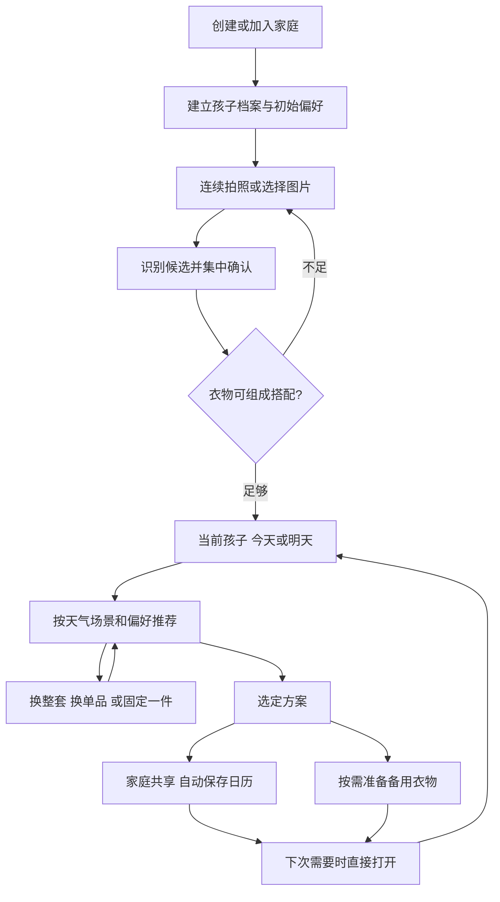

# 智搭重构：首版产品需求与流程

日期：2026-09-13
状态：已讨论需求的汇总稿，待书面审阅；不代表技术选型或实施计划已批准。

## 1. 产品目标

面向衣服偏多、希望省时决策、需要审美帮助且重视舒适的 0–6 岁孩子家庭，从已有衣橱快速给出好看、舒适、适龄、符合天气和活动的一套。

家长端继续使用微信小程序。首版采用“每日搭配优先”，不以整理完整衣橱或持续填写日记为使用前提。AI 试穿后续再做。

成功体验：家长录入一批常穿衣物后，获得愿意采用、能找到实物的搭配；日常再次打开时能快速选衣，忙于照护时无需操作。

## 2. 用户和成长阶段

- 省时决策：直接给方案，减少填写、筛选和重复选择。
- 审美求助：真实衣物组成协调搭配，能解释、能调整。
- 舒适适龄：天气、合身、活动和孩子体感是基本要求。
- 0–1 岁重视穿脱、换洗及连体衣等组合；1–3 岁重视爬行、学步和活动；3–6 岁兼顾幼儿园、自主穿脱和孩子喜好。年龄为默认参考，实际能力和反馈可修正。
- 所有年龄均支持一天多套，重点覆盖 0–3 岁频繁换洗。

## 3. 首版范围

| 模块 | 内容 |
| --- | --- |
| 家庭协作 | 微信邀请、接受加入、管理员／可编辑／仅查看权限、共享孩子与衣橱 |
| 孩子档案 | 多宝、生日、初始风格、身高体重、肤色与舒适偏好、可选照片 |
| 衣物录入 | 连续拍照、多图选择、多件候选识别、集中确认、去重、进度保留 |
| 衣橱 | 浏览筛选、编辑删除、归属调整、状态、转交与共用衣物 |
| 推荐 | 今天／明天、天气场景、审美基准、个人偏好、缓存与规则兜底 |
| 调整 | 换整套、换单品、固定单品、从衣橱指定一件发起搭配 |
| 备用 | 按需准备备用整套或局部衣物，不要求换衣时记录 |
| 日历 | 自动保存已选方案、一天多套、修改撤销、回看复用 |
| 偏好学习 | 明确反馈与选择信号、权重更新、标签查看修改删除 |

后续范围：AI 虚拟模特／试穿；可选准备时间提醒。首版不依赖这些能力。

## 4. 档案与家庭

昵称、生日为基础必填信息。初始风格使用图片示例多选，允许“暂无偏好”。身高体重可填“暂不清楚”，保存测量日期。肤色选填，使用中性描述，仅作配色参考，不设置肤色对应的服装禁忌。照片选填，缺失不影响核心功能。

照片不作为体型、肤色或合身判断的必要条件。身高体重仅辅助判断，具体衣物的合身反馈更直接。

家庭共享地点等信息；各孩子独立保存档案、衣橱归属、舒适要求、场景、方案及偏好。

成员通过邀请并接受后获得访问权。管理员管理成员与设置，至少保留一位；可编辑成员维护数据与方案；仅查看成员查看，不修改。共享界面标明修改人，多人同时修改时提示冲突，不静默覆盖。

每个孩子可选择推荐依据：家庭统一偏好（默认）、指定成员偏好、当前使用者偏好。孩子舒适要求和衣物可用状态始终共享。切换账号或推荐依据不能自动改变已选方案。

## 5. 首次使用与录入

创建／加入家庭 → 建立一个孩子档案 → 录入一批常穿衣服 → 集中确认 → 获得第一次搭配。允许后续补充其他孩子和衣服。

### 5.1 图片与识别

- 实物连续拍照为主，购物图片为补充。默认一张一件，但允许连续拍摄，不必等待识别完成。
- 相册支持多图。购物图片中的多款、多颜色、套装不可全部自动认定为已拥有。
- 多件图片展示候选，让家长选择需要入库的单品；新设计替代旧版只选置信度最高一件的交互。
- 保留原图核对。类型、颜色、图案自动识别，不确定项集中提示；厚薄等无法可靠看出的信息允许确认。
- 品牌、价格等非关键字段不阻塞录入。默认当前合身、可穿，批量保存前明确告知，只改例外。
- 拍摄前选择孩子，本批默认归属该孩子；确认时支持批量调整归属。
- 同图上传去重复用；不同照片疑似同一实物时仅提示，不自动合并，避免误并多宝同款或多件同款。
- 自动保留照片与待确认进度；失败可重试或手填，已完成部分不丢失。

### 5.2 首次价值

已确认衣物可组成完整方案时提供“用这些衣服搭一套”；不足时说明具体缺项。完整方案随年龄、场景、连体衣／裙装等组合变化，不硬性要求上衣、下装、鞋、配件各一件。

## 6. 日常首页

四个入口：搭配、衣橱、搭配日历、我的。

首页顺序：孩子切换 → 今天／明天和对应天气地点 → 当前场景 → 真实衣物主搭配 → 简短理由 → 换一套／选这套 → 按需展开备用衣物。

记住上次孩子与日期模式；日期始终展示实际日期，跨日不能把昨日方案误作今日方案。首次场景为日常，后续沿用每个孩子最近场景，直接推荐后可调整。

切换孩子保留各自调整、固定单品和已选状态。首页不用 AI 试穿图替代真实衣物展示。

### 6.1 选择与修改

- 点击单品可替换、固定；衣橱详情和首页均可选定一件搭配其他衣物。
- “换一套”主动重新生成，固定单品除非用户解除否则保留；没有其他合理组合时明确说明。
- “选这套”保存家庭共享已选方案，重复点击不产生重复记录。
- “修改这套”更新原方案；“新增一套”保留原方案并创建另一套。
- 已选方案不可被天气刷新、后台重新推荐、切换成员或偏好更新静默改写。

### 6.2 换洗与备用

准备时可一次选好主搭配及备用；备用可以是兼容主搭配的上衣、裤子，不强制完整套装。换衣时不要求打开手机，事后不追问补记。

临时操作：今天不穿仅排除本次；待洗暂不可用且支持批量恢复；穿小了移出当前可穿范围并可转交；不喜欢这样搭影响搭配反馈。先完成替换，原因可跳过。

未被告知的实际穿着、换洗和洗衣完成均保持未知，不自动推断。

## 7. 推荐与审美

优先级：可穿与舒适基本条件 → 整套审美协调 → 偏好权重 → 适度变化。

默认日常耐看，风格与场景决定变化幅度。审美库版本化维护颜色、图案、款式层次、场景、年龄和天气规则，包含摘要、来源与正反例；规则兜底与模型共享基准。来源必须可追溯，未调研内容不得标为已验证趋势。

偏好不能越过天气、合身等基本要求；肤色仅柔性参考。衣橱不足不虚构单品，不为减少重复勉强组合。

同日期同有效输入复用推荐。有效输入包括孩子资料、目标日期、天气地点、场景、可用衣橱、推荐依据及偏好版本、审美规则版本、固定／排除条件。不同成员使用不同偏好时不能混用缓存。

天气／衣橱变化可刷新未选建议；已选方案提示影响并由家长决定。模型失败使用同规则兜底；无法组成合理搭配时说明缺项。天气不可用时明确不确定性，不伪造天气数据。

家庭共用的是同一件实物，已计划给一个孩子同日使用时需要提示占用，避免另一孩子被无提示地分配同件衣物；具体冲突粒度见第 11 节。

## 8. 偏好学习

| 信号 | 含义 |
| --- | --- |
| 建档选择、明确修改标签 | 明确意图，优先参考 |
| 明确喜欢／不喜欢及原因 | 较强反馈，区分审美和舒适 |
| 最终选择的搭配 | 正向但较弱，不代表已实际穿着 |
| 浏览、无原因换一套 | 弱线索，不立即形成强标签 |
| 待洗、找不到、穿小了 | 可用或合身状态，不推断审美 |
| 未补记、未返回 | 无反馈，不视为不喜欢 |

观察多次一致行为后总结标签，显示依据，允许修改删除。家庭统一、指定成员和当前成员的反馈归属需明确，不将所有人的操作无差别混合。

## 9. 日历与数据含义

自动积累的是已选方案，不是完整穿着事实。支持同孩子同日期多条记录、修改、撤销与再次使用。复用旧方案时重新校验当前天气、合身和可用状态。

如提供可选“确认穿过”，须与“已选”明确区分，不要求用户补齐。首版不以不完整记录展示精确穿着次数或闲置结论。近期已选仅柔性降低重复优先级，不强制禁穿。

## 10. 验收场景与观察指标

1. 无照片、身高体重暂不清楚的孩子可完成建档和推荐。
2. 连续录入中断后恢复；同图不重复上传，多件候选可确认归属。
3. 默认合身可穿，家长只改例外；足够搭配时可提前结束录入。
4. 同家庭多宝切换不丢方案；未经邀请的账号不能读取家庭数据，仅查看成员不能修改。
5. 今天／明天使用正确日期天气；相同条件不反复生成，不同偏好不能误用同一缓存。
6. 换整套、换单品、指定一件均可完成；已选方案不会静默更新。
7. 同日可新增多套，与修改明确区分；重复保存不重复创建。
8. 家长完全不记录换洗，次日仍可正常推荐；未知状态不被伪造成事实。
9. 待洗等临时理由不形成审美标签；明确修正标签后影响后续推荐。
10. 识别、天气或推荐失败时有可继续的流程，已有数据与方案保留。

观察首次可用搭配所需时间、录入中断恢复情况、获得推荐后的采用与调整情况、再次需要搭配时的回访，以及推荐不可用原因。具体目标通过试用建立，不预设虚构达标数值；不以补记率作为核心指标。

## 11. 下一轮技术设计需要解决的边界

以下是待提出方案的设计问题，不是遗漏的已确认需求，也不代表已批准实现：

- 家庭权限落到对象归属、邀请有效期、退出与数据保留的具体规则。
- 共用衣物在主搭配、备用、多套和不同时间的占用冲突及用户覆盖规则。
- 多件识别的候选图片呈现方式、原图与单品图的关系和误合并处理。
- 偏好更新阈值、衰减、明确标签删除后的行为，以及多成员反馈归属。
- 推荐缓存与已选方案分离、跨日和天气更新判定、并发修改处理。
- 天气来源、模型与图片存储适配、任务恢复、超时重试和成本控制。
- 旧数据是否迁移、旧版并行保留方式、上线部署与回退边界。

建议按家庭档案、衣橱录入、推荐与方案、反馈日历四个模块分别细化技术设计，以可运行的完整使用流程分阶段验收。

## 12. 核心流程图

